# iFlow Harness for VSCode

**心流·驭光** — 把 iFlow 内核的 agent 能力图形化地接入编辑器：通过 [ACP（Agent Client Protocol）](https://agentclientprotocol.com) 驱动内置裁剪 CLI 子进程，以 NDJSON 分帧的 JSON-RPC 2.0 双向通信，在编辑器标签页里完成对话、工具审批、Diff 回退、轮级回滚、会话持久化与恢复的完整 agent 工作流。会话状态只保存在扩展宿主，面板是它的投影。

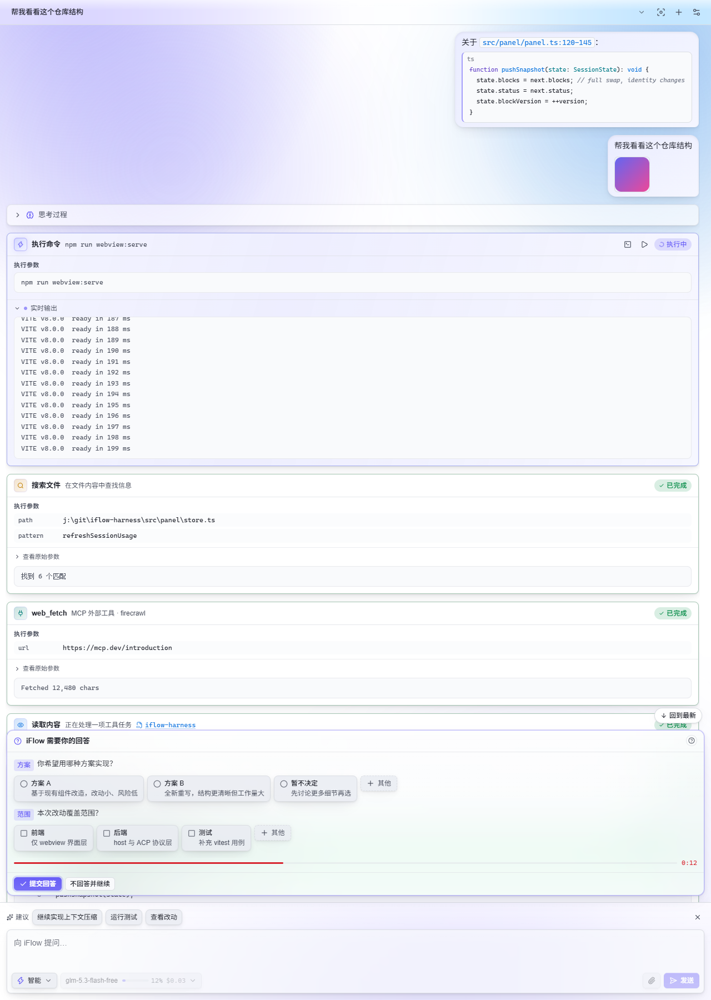

## 架构

三层单向数据流：

```
webview/（React 投影）  ←── snapshot / blockPatch ←── shared/（纯 reducer） ←── ACP 事件 ──  src/（Extension Host）  ←── NDJSON ──  内置 CLI 子进程
webview/（用户操作）   ──→ WebviewToHost 消息 ──→ src/panel/panel.ts 路由 ──→ AcpClient 调用
```

- **状态只存在于 Extension Host**：`shared/session-state.ts` 的纯 reducer 处理所有 ACP 事件，`src/panel/store.ts` 节流快照并通过 `blockPatch` 增量下推；WebView 不跑协议逻辑，只渲染快照，也不持有会话真值。
- **执行体固定为内置裁剪 CLI**：`vendor/iflow-cli`（默认源自仓库内 `vendor/iflow-fork` 快照）。`resolveVendoredEntry` 硬解析入口，缺失即报错；不探测系统可执行文件搜索路径，不回退到 npm 或本机安装的 CLI。loader 补丁只存在于这份 bundle，跑官方包会静默改变 agent 行为，因此宁可报错也不兜底。
- **协议层零 VSCode 依赖**：`src/acp/jsonrpc.ts` 负责 NDJSON 分帧（8MB 帧上限）与 JSON-RPC 路由；TypeScript strict + Node16 模块解析，import 一律带 `.js` 扩展名。

## 超流（多超流体）

主会话是协调者：把可独立完成并验证的工作单元写成任务书，**单层拆解**派发给超流体（子会话不再继续派发下级子会话）。每个超流体 = 独立 CLI 进程（各带 cwd 与凭据）+ 独立 ACP 会话 + 独立 git worktree / 分支（`iflow/super/<slug>-<unique>`），因此多个超流体同时改同一个项目也不会互相踩踏。

顶栏「超流体」控件是看板入口：折叠时只报计数与待处理数，展开后逐行给出状态、分支与工作目录、汇报摘要，以及中断 / 合并 / 清理操作。超流体始终免确认（宿主直接放行 `request_permission` 与残留的 plan 退出事件），只有它真的需要你回答时才把提问推到你面前。结束后由宿主**串行**把分支合并回来——合并前先用 `git merge-tree` 在对象库里预演，只有会覆盖你未提交的改动或仓库正处于合并中途时才让路，绝不替你 commit / stash / 撤销本地改动；也可配置为推送分支开 PR，或只保留分支由你在看板手动合并。

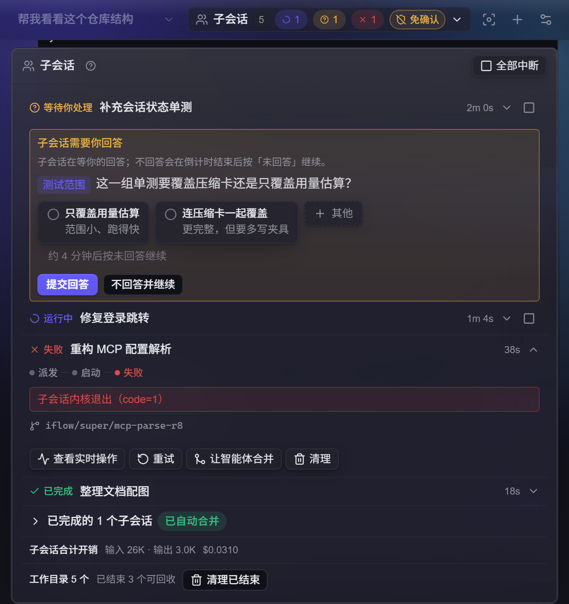

主会话写下的任务书渲染成独立卡片（正文结构化排版、单一展开入口），与宿主实际派发的载荷同源：

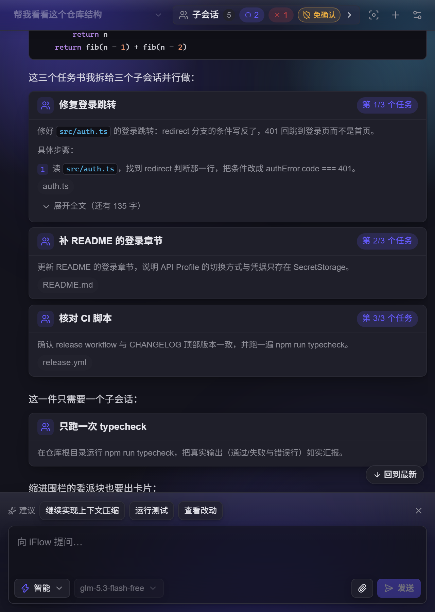

## 亮点

- **完整 agent 工作流**：流式对话、审批卡内嵌只读 Diff（批的是变更本身而不是一个标题）、行号 Diff 逐块 hunk 保留/回退、可勾选的任务清单卡、交互式提问卡、子代理进度卡片与单独停止、消息排队与打断发送（Steer）。
- **可回退的长任务**：轮级 Checkpoint 影子快照支持「回滚到此轮」（文件 / 对话 / 两者），编辑旧消息重发自动先恢复该轮快照；速率限制递增退避自动重试、上下文溢出自动压缩并重发——限流与长上下文都不再中断任务。
- **记忆与项目知识库**：层级记忆加载（primary + 祖先 + 递归），面板直接读写内核真正加载的记忆文件（按事实条目增删、token 成本、冲突检测）；`save_memory` 支持 `scope`（`global` 默认 / `project`）；项目知识库走文末托管块注入并支持增量刷新（无变化不调模型）。
- **模型元数据不编造**：模型列表实时查询当前端点的 `/models`；上下文窗口、单价与思考能力可由「联网补充模型数据」补齐——宿主侧直连检索官方资料，交给当前模型提炼，解析器逐条校验溯源（数字必须能在引用的来源原文中找到），不满足即整条丢弃。
- **CLI 资产与 MCP 配置管理**：MCP 供超流体使用（主会话进程禁用 MCP、不带 MCP 工具）；目录卡片展示连接状态、工具 schema、prompts 与失败原因，配置编辑器表单化（全局 / 项目双作用域）；技能 / 命令 / 子代理资产可视化浏览。
- **凭据与审批安全**：API Key 只存 VSCode SecretStorage（不落盘明文、不打日志），面板配置与终端内核隔离；审批默认拒绝、5 分钟超时自动拒答并带存活看门狗；提问卡与审批共用同一超时，超时按空答案继续，避免 agent 永久阻塞；Webview 走 nonce CSP + DOMPurify 净化；协议层文件读写已做目录边界校验。
- **精致界面**：统一控件套件（按钮 / 输入 / 下拉 / 开关 / 滑块 / 浮层只有一个之家）、Win12 风格亚克力材质、深浅色主题、可调字号与密度、可调极光背景、Mermaid 图表、超长会话离屏渲染不卡。
- **内核兼容增强**：内置一组定制 Mod/loader——按模型配置输出 token 上限、真实上下文窗口计算、Kimi 采样参数规范化、多模态视觉跟随当前模型、思考参数规则、MCP 后台发现与跨会话连接池、slash 压缩结果落盘、按 agentId 单独停止子代理、权威上下文占用上报、MCP 连接状态上报、系统提示词覆写（cwd / git HEAD / 当前模型保持 live）、API 配置隔离（面板凭据不泄漏进共享 settings.json）、联网搜索后端替换（第三方网关 key 也能检索）。鉴权统一为 OpenAI 兼容方式：打包期注入 `oauth-strip` / `telemetry-strip` / `internal-host-strip` 三个 loader 去掉内核的 OAuth 登录、遥测上报与云主机默认值，另有 `memory-scope-loader` 给 `save_memory` 增加 `scope`。内核不再支持官方 OAuth 登录，依赖 iFlow 账号 OAuth 的用户需改用 API 配置（baseUrl + apiKey + modelName）；显式配置的 baseUrl（含指向 iFlow 主机）不受影响，缺 baseUrl 时直接报错。

## 功能

**对话与生成**

- 流式对话：思考过程折叠、Markdown 渲染（代码块语法高亮 + Mermaid 图表）、一键中断
- 消息排队与打断发送：生成中继续输入即入队（上限 10 条），队列条支持编辑取回 / 删除 / 上下移 / 立即发送（打断当前轮）；本轮失败自动暂停队列
- 子代理卡片：按类型着色、步骤进度、嵌套子代理、token 与耗时统计，可单独停止某个子代理（父代理继续跑）
- 提问卡：`ask_user_question` 发起时渲染交互卡，支持单选 / 多选 / 自由文本，选项自带说明；与审批共用 5 分钟超时，超时按空答案继续，不阻塞 agent
- 任务清单卡：内核输出的待办清单渲染成可勾选的任务列表卡（勾选只影响面板显示，不回写内核）
- 回合末一次调用：AI 标题、下一步建议、记忆提取合并成一次模型请求（按已开启项拼任务），缺项降级为空，绝不伪造
- 消息操作：重新生成、复制、记住这条
- 用量与成本：会话累计 token 消耗（末次请求上下文为权威值，其余真实 BPE 估算），输入 / 输出分列、上下文占用百分比与成本估算实时刷新；上下文窗口按「用户覆写 > 接口配置档 > 内核配置 > 内核模型表」解析并推送给 CLI，使自动压缩阈值与面板显示一致
- 自动恢复：速率限制递增退避重试，上下文溢出自动压缩并重发原 prompt，等待过程以倒计时通知呈现
- 会话管理：历史搜索 / 切换 / 重命名 / 置顶 / 归档 / 删除（两步确认），transcript 原子落盘并在重启后自动恢复

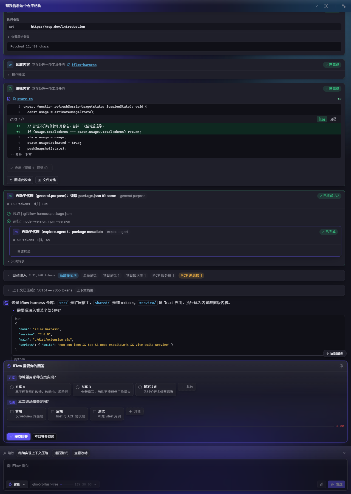

**工具与审批**

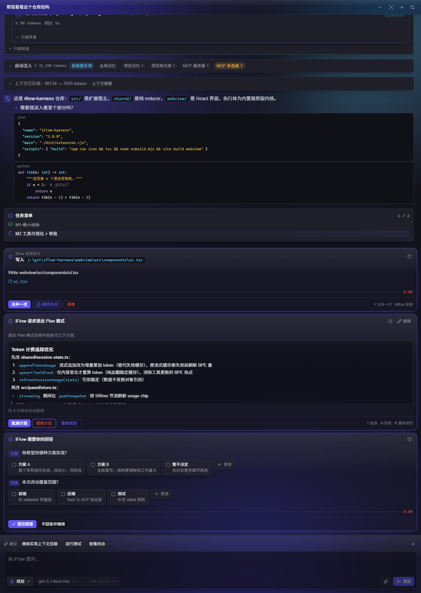

多张待处理卡（审批 / 提问）同时到达时改为堆叠形态，只完整显示最新一张，顶部计数器可展开为完整列表：

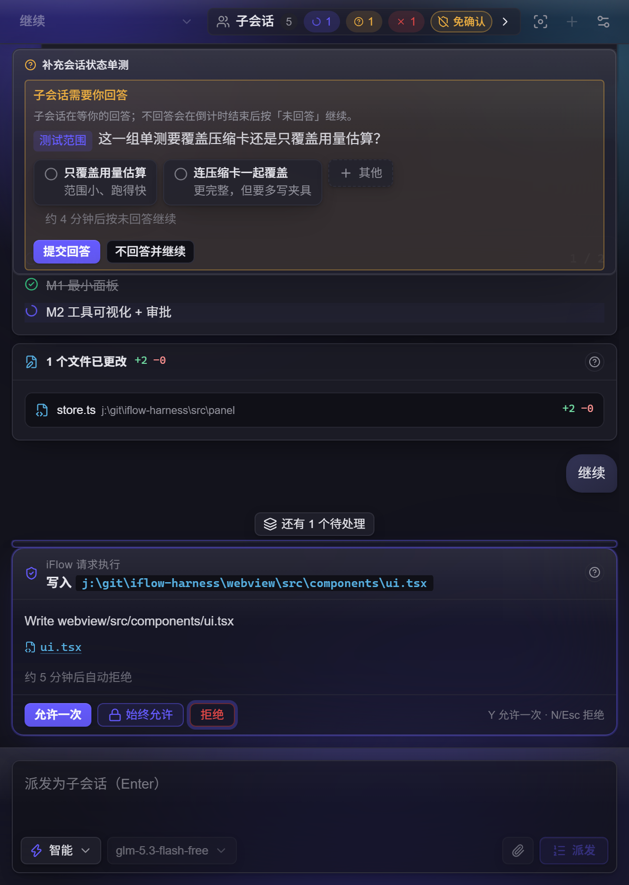

- 工具调用卡片：按工具名映射标签 / 图标 / 强调色，执行参数结构化摘要 + 原始参数懒挂载折叠，长驻命令实时输出流
- 行号 Diff 视图：每个 hunk 可单独保留 / 回退，提交后按保留块确定性写盘；支持整文件回退与 VSCode 原生并排对比（文件对比）
- 审批流：请求卡片（允许一次 / 始终允许 / 拒绝），5 分钟超时自动拒绝并带存活看门狗解锁输入；键盘快捷键 `Y` / `N`

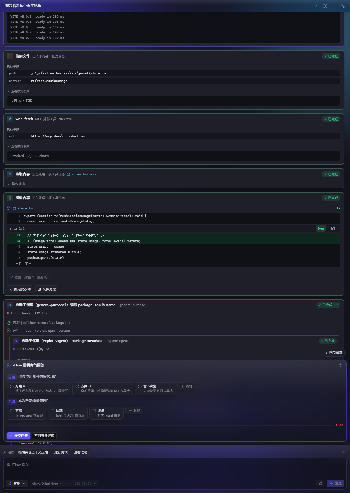

**Checkpoint 与工作区回退**

- 每轮对话前把工作区快照到独立的影子 git 仓库（绝不触碰你自己的 `.git`，非 git 目录同样可用）
- 用户气泡「回滚到此轮」三档恢复：仅文件 / 仅对话 / 文件+对话；编辑器未保存修改与整仓覆盖双重复确认
- 快照容量可治理：文件数 / 单文件大小 / 轮数 / 总体积上限，超限自动关闭或清理

**上下文与输入**

- `@` 上下文源：`@文件` 工作区模糊搜索、`@/` 文件夹搜索、`@problems` 注入工作区诊断、`@git` 注入 status+diff、`@url:` 抓取网页正文、`@terminal` 注入终端记录；多工作区根可用 `@<根别名>/<路径>` 精确指定
- 多工作区根：多仓库工作区的输入框提供「目标根」选择器，勾选只影响之后新建的会话（当前会话的 cwd 与上下文不变，至少保留一根）；新会话据此通过 `settings.add_dirs` 限定注入 CLI 的根目录，勾选全部时省略该字段并回落为启动参数的全量根
- 上下文透明卡：每次请求实际注入的系统提示词、记忆、context files 与知识库渲染成可展开的注入卡，附 token 成本（主会话不再注入 MCP 声明）
- 选区上下文：编辑器右键询问 iFlow（直接提问）/ 加入 iFlow 上下文（生成代码上下文卡，发送时前置到 prompt，可移除、多卡并存）
- 附件：粘贴 / 拖拽 / OS 文件选择器多路径添加，图片缩略图回显并可预览，灯箱支持 `Esc` 关闭与 `←`/`→` 切换；为图片填写的单行说明按图片顺序生成带序号清单发给模型；最多内联 4 张图片，超出部分忽略；单张 >5MB 的图片降级为文件附件
- 提示词增强：一键将草稿改写为更清晰的请求
- Chat Participant：VSCode Chat 中 `@iflow` 纯文本通道，富交互仍在面板内

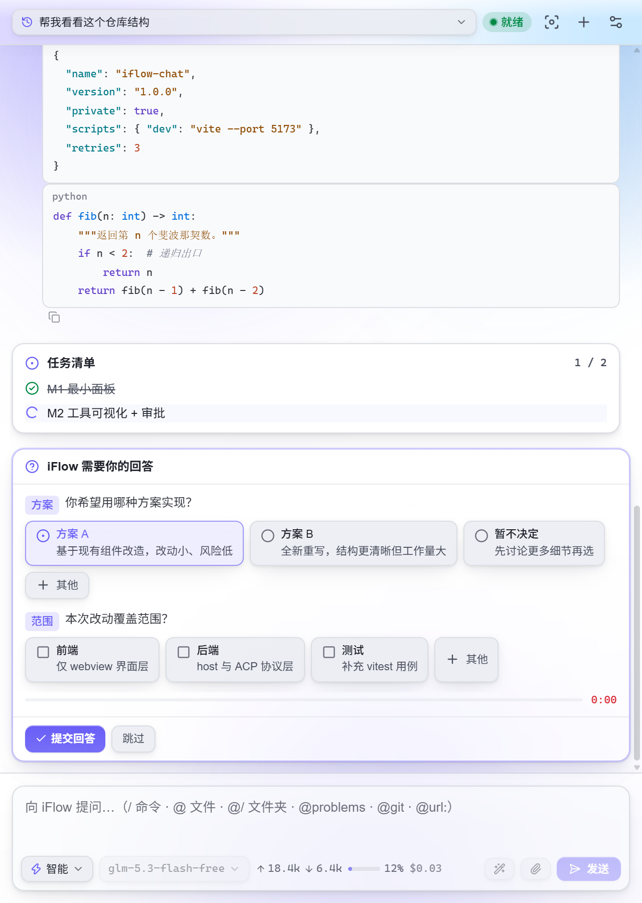

**记忆与知识库**

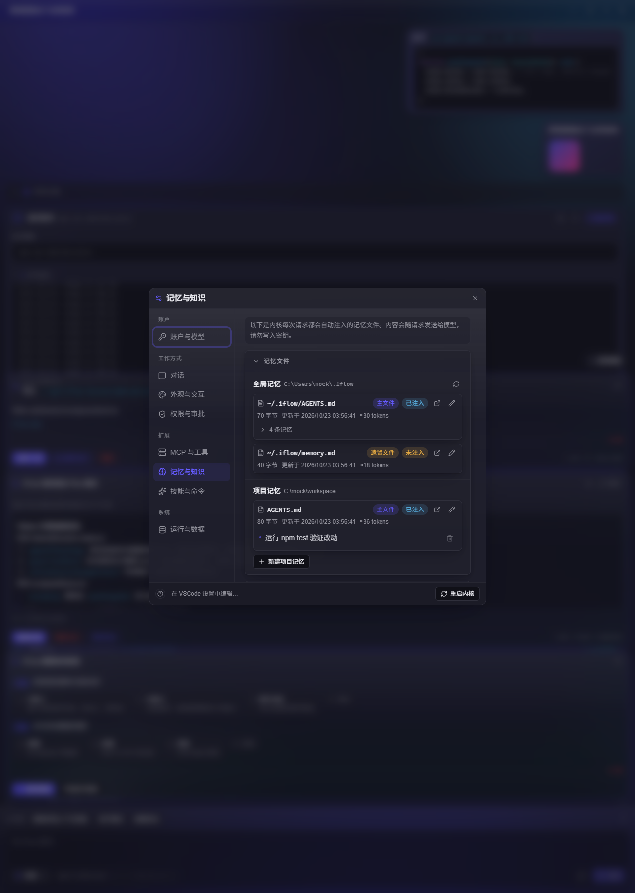

- 层级记忆加载：内核加载 primary + 祖先 additional + 递归 hierarchy 的 `AGENTS.md` / `IFLOW.md`；面板读取 / 内联编辑这些真正生效的文件，按事实条目追加与删除，展示 token 成本与 sha256 冲突检测；遗留 `memory.md` 只展示不注入
- `save_memory` 的 `scope`：`global`（默认，写用户级记忆）/ `project`（写当前工作区），扩展只做 loader 注入，写入本身仍委托内核，字节布局不漂移
- 快捷记忆：助手消息行内「记住这条」弹窗（全局 / 项目作用域）、编辑器右键「记住选中内容」
- 自动提取：回合结束后用当前模型提取长期偏好与约定作为候选，去重 + 置信度门控 + 最多 5 条，**确认后才写盘**
- 项目知识库：扫描工作区生成 `.iflow/knowledge/index.md` + `manifest.json`，增量刷新只处理新增 / 修改 / 删除的文件，索引 hash 不匹配时要求显式全量重建（绝不静默覆盖手改内容）；注入走文末托管块 `@.iflow/knowledge/index.md`，遵循内核的 context files 规则
- 记忆整理：面板空闲时定期整理自动维护段，距上次成功整理达到间隔天数、或托管段 token 合计超过总预算（带冷却）即触发一轮，默认「只预览」不改文件，「执行」策略会先备份再改写

**模型与配置**

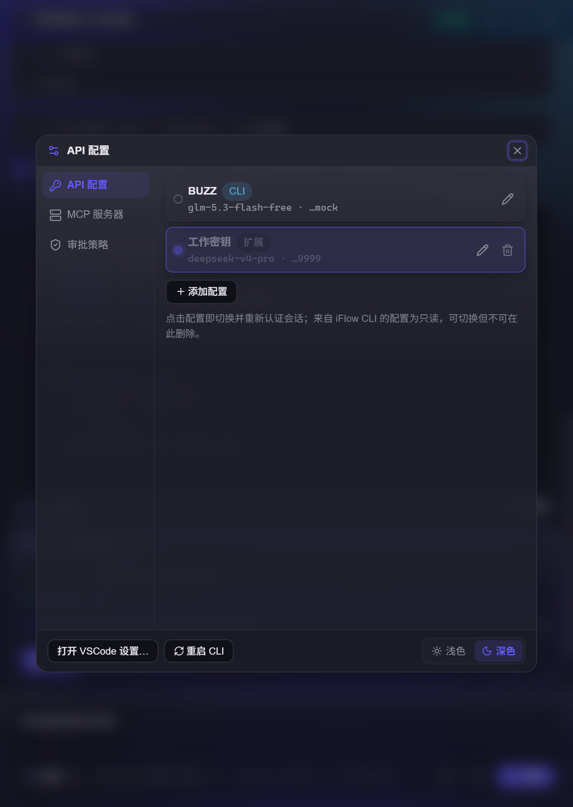

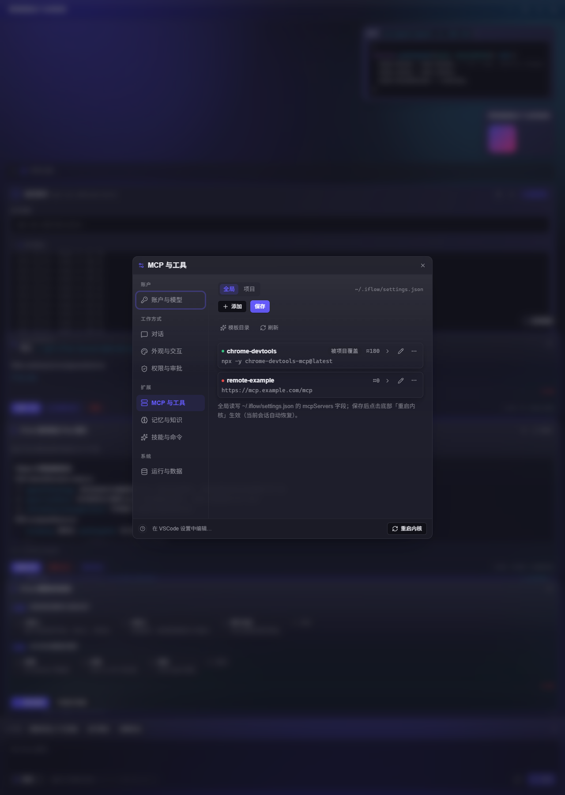

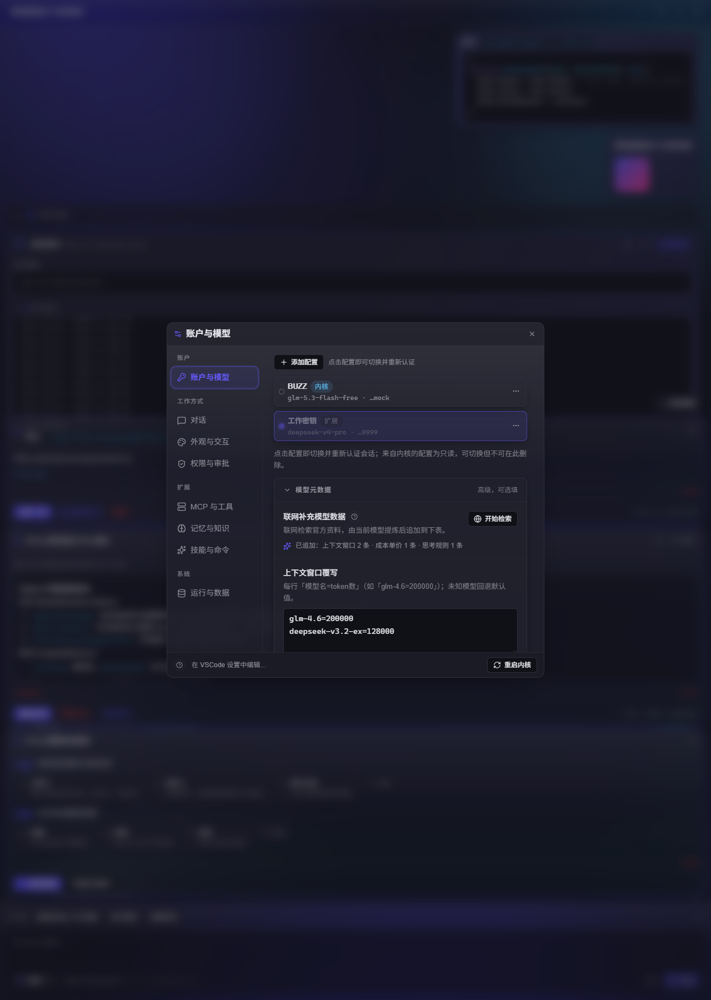

- API 配置：OpenAI 兼容凭据存 SecretStorage，多 Profile 热重认证免重启内核；切换时可选择保留当前会话原地重载；首次使用有引导向导与提供商预设（切换预设不继承旧网关模型名）
- 模型列表实时查询当前端点的 `/models`，下拉模糊搜索；模型下架时显式回退并提示，绝不静默用错模型
- 模型元数据：上下文窗口覆写、成本单价表、思考能力规则；「联网补充模型数据」宿主侧检索官方资料后由当前模型提炼，逐条溯源校验并**只追加不覆盖**
- 推理级别：自动 / 快速 / 平衡 / 深度，按模型能力灰化；规则与 `~/.iflow/thinking-models.json` 双向同步
- MCP 服务器管理：MCP 供超流体使用（主会话上下文不再计入 MCP 成本），目录卡片显示来自共享代理的连接状态与工具数，详情子页含 transport / schema / 失败原因；连接失败按 `spawn_failed` / `timeout` / `protocol_error` / `network_error` 给出可执行引导（查命令、刷新、改 URL/请求头、查网络代理），模板目录按核心 / 浏览器 / 工作流分组并标注推荐项；单个服务器的工具 schema 超过 4MB JSON 预算时截断并标记 `schemaOmitted`，声明合计超过约 8000 tokens 时给出上下文占用警告；表单化编辑器支持全局与项目双作用域，保存原子写回并一键热重启
- CLI 资产：技能 / 命令 / 子代理列表可视化浏览与编辑
- 会话导出：Markdown / JSON / 脱敏 ACP 通信日志（命令面板，见下方命令列表）

**QQ 远程渠道**

- 通过 QQ 远程提交任务，按 openid 白名单限定用户与群；工作区必须是当前工作区根，否则服务拒绝启动
- 三档远程策略：`readonly`（只读，写文件与执行命令被拒）/ `supervised`（默认，工具调用需在 QQ 审批，4 分钟未响应按拒绝）/ `trusted`（无需审批，仅限完全掌控的账号与群）
- 并发任务数与每分钟接受数可限流，回传结果详细程度可选 `summary` / `standard` / `full`，完成后是否自动合并分支可配

**界面与通知**

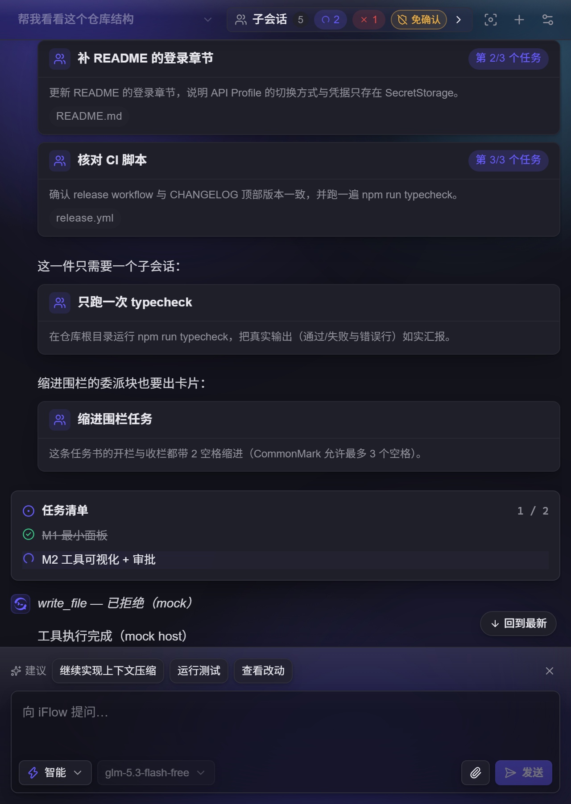

- 主题：深 / 浅色切换，默认跟随编辑器主题；字号（紧凑 / 标准 / 大）与密度（紧凑 / 标准 / 宽松）可调；极光背景强度可调
- Focus 视图只看对话；状态栏显示 agent 状态（连接中 / 就绪 / 生成中 / 等待审批 / 出错）与当前模型，点击打开面板
- 通知分层：面板内 toast 栈与粘性「生成中」pill（限流 / 压缩倒计时合并进 pill，锚定宿主绝对截止时间）、错误与未配置凭据走转录上方的 inline banner、离开面板时按策略发 OS 系统通知
- 提示音：完成 / 失败音效（Web Audio 合成，无需资源文件）
- 长会话：超长转录离屏渲染 + 后缀挂载窗口，折叠内容首次打开才挂载，旧块重 payload 自动释放

## 前置要求

- VSCode `^1.90.0`
- 无需单独安装 iFlow CLI：执行体固定为随包分发的内置裁剪 CLI，缺失即报错
- 可用的 OpenAI 兼容 API 端点（baseUrl + apiKey + modelName）

## 扩展设置

以下键全部来自扩展清单声明（共 57 项）；默认值即 `package.json` 中的 `default`。

**面板行为**

| 设置项 | 默认值 | 说明 |
|---|---|---|
| `iflow.warmStart` | `true` | 窗口打开时后台预热内核，首次打开面板无需等待（每窗口约 100MB 内存） |
| `iflow.autoOpenPanel` | `false` | VSCode 启动后自动打开聊天面板 |
| `iflow.restoreLastSession` | `false` | 面板启动时恢复上次使用的会话，无可恢复记录则新建 |
| `iflow.autoTitle` | `true` | 会话首轮完成后生成 AI 简短标题 |
| `iflow.nextStepSuggestions` | `true` | 每轮结束后预测下一步并显示输入框上方的候选 chip（额外一次模型调用） |
| `iflow.nextStepTimeoutSeconds` | `25` | 下一步建议最长等待秒数，0 = 不限（范围 0–300） |
| `iflow.soundFeedback` | `true` | 对话完成 / 失败时播放提示音 |
| `iflow.osNotifications` | `approvals` | 面板不可见时的系统通知：`off` / `approvals` / `all` |
| `iflow.theme` | `auto` | 面板主题：`auto` 跟随编辑器，或固定 `light` / `dark` |
| `iflow.uiFontSize` | `standard` | 面板字号：`compact` / `standard` / `large` |
| `iflow.uiDensity` | `standard` | 面板疏密：`compact` / `standard` / `comfortable` |
| `iflow.auroraIntensity` | `35` | 背景极光光斑强度（0–100，0 隐藏） |

**效率与语言**

| 设置项 | 默认值 | 说明 |
|---|---|---|
| `iflow.efficiencyMode` | `steady` | 提示词档位：`steady`（默认规则）/ `turbo`（快速产出、减少探索），含子会话，立即生效 |
| `iflow.language` | `""` | 内核界面语言（`""` / `zh-CN` / `en-US`），留空不干预，重启内核后生效 |

**超流体（Super Agent）**

| 设置项 | 默认值 | 说明 |
|---|---|---|
| `iflow.superAgent.integration` | `merge` | 完成后带回改动的方式：`merge` / `pr` / `manual`（合并前预演，冲突在写入前识别） |
| `iflow.superAgent.maxConcurrent` | `5` | 同时运行的超流体数量上限（1–20），超出排队，立即生效 |
| `iflow.superAgent.maxAttempts` | `2` | 失败后最多自动尝试次数（含首次，1–5） |
| `iflow.superAgent.dependencyPolicy` | `block` | 上游失败时依赖任务：`block` 跳过 / `continue` 照常执行 |
| `iflow.superAgent.fullTrust` | `false` | 完全信任模式：直接在主仓运行、保留全部工具与 MCP、可 push / 开 PR / 合并（谨慎开启） |
| `iflow.superAgent.keepWorktree` | `false` | 正常完成后是否保留工作目录；失败 / 中断始终保留 |
| `iflow.superAgent.maxWorktrees` | `10` | 磁盘最多保留的已结束工作目录数（0–100，0 = 不限），分支一律保留 |
| `iflow.superAgent.defaultWorkspace` | `""` | 未打开文件夹时的默认工作区，留空用 `~/.iflow/workspace` |
| `iflow.superAgent.childToolAllowlist` | `[]` | 限制超流体可用的内置工具名，留空不限制 |
| `iflow.superAgent.childMcpServerAllowlist` | `[]` | 限制超流体可访问的 MCP 服务器名，留空不限制 |
| `iflow.superAgentProfile` | `""` | 超流体请求使用的 API 配置名，留空跟随主会话 |
| `iflow.superAgentModel` | `""` | 超流体请求使用的模型 id，留空用所选配置的模型名 |

**QQ 远程渠道**

| 设置项 | 默认值 | 说明 |
|---|---|---|
| `iflow.qq.enabled` | `false` | 是否启用 QQ 远程任务通道 |
| `iflow.qq.allowedUsers` | `[]` | 允许提交任务的 QQ 用户 openid，留空不接受单聊任务（建议不要提交到版本库） |
| `iflow.qq.allowedGroups` | `[]` | 允许提交任务的 QQ 群 openid，留空不接受群聊任务 |
| `iflow.qq.workspace` | `""` | 远程任务运行的工作区目录，须为当前工作区根，留空即当前根 |
| `iflow.qq.remotePolicy` | `supervised` | 远程任务可执行的范围：`readonly` / `supervised` / `trusted` |
| `iflow.qq.maxConcurrentTasks` | `2` | 同时运行的远程任务数（1–10） |
| `iflow.qq.rateLimitPerMin` | `6` | 每分钟最多接受的远程任务数（1–60） |
| `iflow.qq.resultDetail` | `standard` | 回传结果详细程度：`summary` / `standard` / `full` |
| `iflow.qq.autoMerge` | `false` | 远程任务完成后是否自动合并其分支 |

**模型与内核**

| 设置项 | 默认值 | 说明 |
|---|---|---|
| `iflow.nodePath` | `""` | 启动内核所用的 Node.js 可执行文件，留空则自动查找可用版本 |
| `iflow.contextWindowOverrides` | `[]` | 上下文窗口覆写，每行 `模型名=Token数`（如 `glm-4.6=200000`） |
| `iflow.costTable` | `[]` | 成本单价表，每行 `模型名=输入价,输出价`（USD/百万 Token） |
| `iflow.thinkingModelRules` | 内置 6 条 | 思考能力规则（`pattern` / `supportsThinking` / 可选档位与上限），不区分大小写、先命中生效 |

**记忆与知识库**

| 设置项 | 默认值 | 说明 |
|---|---|---|
| `iflow.autoMemoryCapture` | `true` | 每轮结束后提取长期记忆候选，确认后才写盘（额外 token） |
| `iflow.memoryExtractTimeoutSeconds` | `90` | 记忆提取最长等待秒数，0 = 不限（0–600） |
| `iflow.memoryMaintenanceEnabled` | `false` | 面板空闲时定期整理记忆自动维护段，默认只预览不改文件 |
| `iflow.memoryMaintenanceIntervalDays` | `7` | 自动整理周期（天，1–90） |
| `iflow.memoryMaintenanceIdleMinutes` | `15` | 空闲多少分钟后才整理（1–240） |
| `iflow.memoryMaintenanceGlobalTokenBudget` | `4000` | 全局记忆自动维护段的 token 上限（500–50000） |
| `iflow.memoryMaintenanceProjectTokenBudget` | `2500` | 每个项目记忆文件自动维护段的 token 上限（500–50000） |
| `iflow.memoryMaintenanceTotalTokenBudget` | `12000` | 所有记忆文件自动维护段的 token 合计上限（1000–200000） |
| `iflow.memoryMaintenanceStrategy` | `report` | 整理策略：`report`（只预览）/ `apply`（备份后改写） |

**上下文与压缩**

| 设置项 | 默认值 | 说明 |
|---|---|---|
| `iflow.autoCompressOnIdle` | `false` | 回合结束且占用达阈值时，下一条消息前自动压缩 |
| `iflow.autoCompressThresholdPercent` | `95` | 触发自动压缩的上下文占用百分比（50–100） |
| `iflow.compressTimeoutSeconds` | `0` | 压缩会话最长等待秒数，0 = 不限（0–600） |

**Checkpoint（轮级快照与回退）**

| 设置项 | 默认值 | 说明 |
|---|---|---|
| `iflow.checkpoints` | `true` | 每轮对话前快照工作区到影子 git 仓库（不碰用户 `.git`） |
| `iflow.checkpointMaxFiles` | `50000` | 工作区文件数超过该上限时关闭快照 |
| `iflow.checkpointMaxFileMB` | `300` | 跳过大于该尺寸（MB）的文件，0 = 不限 |
| `iflow.checkpointDir` | `""` | 快照仓库自定义根目录，留空用默认存储位置 |
| `iflow.checkpointMaxTurns` | `0` | 每会话最多保留的快照轮数，0 = 不限 |
| `iflow.checkpointMaxSizeMB` | `0` | 快照仓库总体积上限（MB），0 = 不限 |

## 命令

命令面板（`Ctrl/Cmd+Shift+P`）中可用的命令，id 与标题均与扩展清单一致：

| 命令 id | 标题 |
|---|---|
| `iflow.openPanel` | iFlow：打开聊天面板 |
| `iflow.newSession` | iFlow：新建会话 |
| `iflow.askSelection` | 询问 iFlow |
| `iflow.addSelectionToContext` | 加入 iFlow 上下文 |
| `iflow.rememberSelection` | 记住选中内容 |
| `iflow.curateMemory` | 立即整理记忆 |
| `iflow.restartCli` | iFlow：重启（使设置生效） |
| `iflow.exportSessionMarkdown` | iFlow：导出会话为 Markdown |
| `iflow.exportSessionJson` | iFlow：导出会话为 JSON |
| `iflow.exportWireLog` | iFlow：导出内核通信日志（敏感信息已隐去） |

其中 `iflow.askSelection` / `iflow.addSelectionToContext` / `iflow.rememberSelection` 也挂在编辑器右键菜单（有待选区时显示）。

## 使用

1. 安装扩展后，点击状态栏右侧的心流状态项打开面板（也可用编辑器标签栏图标或命令面板 `iFlow：打开聊天面板`）；面板是独立编辑器标签页，宽度可自由拖拽
2. 首次使用按引导向导配置 API 凭据（OpenAI 兼容地址 + Key + 模型名），或切换内核已有的配置
3. 输入消息开始对话；生成中可以继续输入排队、「立即发送」打断当前轮；工具调用会在面板中请求审批，Diff 卡片支持逐块保留 / 回退与文件对比；用户气泡可回滚到此轮
4. 输入框 `@` 触发文件 / 文件夹 / 诊断 / git / 网页 / 终端上下文，多根场景可用 `@<根别名>/<路径>`；Chat 视图中 `@iflow <问题>` 走纯文本通道快速提问
5. 需要模型窗口与单价数据时在设置「账户与模型」里点「联网补充模型数据」——宿主侧检索、当前模型提炼、溯源校验后追加到元数据表
6. 会话导出、重启内核、整理记忆等可从上方命令面板列表执行

> **安全与信任边界**：内核的执行类工具（`run_shell_command` 等）运行在本机真实 shell 中，可以读写会话目录之外的任意路径——审批卡是「告知 + 同意」，不是沙箱隔离。超流体免确认同样不提供沙箱。请在信任的项目中使用；处理不信任的代码库时，建议在容器 / 虚拟机中运行 VSCode。扩展侧的 `fs/read_text_file` / `fs/write_text_file` 回调已做目录边界校验（允许范围 = 会话目录 + 所有已打开工作区根；`..` 上逃与指向范围外的绝对路径会被拒绝），但这只封住了协议层通道，不替代操作系统级隔离。

## 开发与构建

```bash
npm ci                 # 安装依赖
npm run typecheck      # typecheck:host + typecheck:webview + typecheck:test（全部 --noEmit）
npm test               # vitest run（单次，非 watch）
npm run build          # l10n:check + icon + tsc + esbuild(host) + vite build(webview)
npm run webview:dev    # webview 增量构建（watch）
npm run webview:serve  # 静态服务 webview/dist（默认 127.0.0.1:8791）
npm run vendor:cli     # 从 vendor/iflow-fork 快照生成 vendor/iflow-cli
npm run defaults:sync  # 把本机 ~/.iflow/ 默认规则同步到 scripts/iflow-defaults/
npm run harness        # 驱动真实 CLI 跑 ACP 全流程（需先 build）
npm run lint:deps      # knip 死代码 / 依赖检查（CI 闸门）
npm run package        # vendor:cli --force && build && vsce package --no-dependencies
```

- 本地 F5 调试前必须先 `npm run build`（`main` 指向 `./dist/extension.cjs`，webview 读 `webview/dist/index.html`），并至少跑一次 `npm run vendor:cli`。
- `vendor/iflow-cli` 被 gitignore，缺失时扩展直接报「内置 CLI 缺失」——这是刻意设计，没有本机 CLI 兜底。
- `npm run harness` 从构建中间产物导入，既是 ACP 全流程冒烟测试，也是裁剪后 CLI 的验收手段。
- 新增用户可见设置项要同步 `package.nls.json` 与 `package.nls.zh-cn.json`；新增 wire 消息要同时更新 `shared/messages.ts` 两侧联合类型。

## 发布

- `CHANGELOG.md` 顶部是版本唯一来源且与 `package.json` 的 `version` 双处同步：release 流程从 `## [x.y.z]` 读取版本与摘要写入 `package.json`，因此新增版本必须同时更新两处再提交。
- `ci.yml` 与 `release.yml` 都只针对 `release` 分支，`master` 不跑 CI：`ci.yml` 在 push 与 PR 到 release 时触发三平台矩阵（ubuntu / windows / macos）的 `npm ci` → typecheck → lint:deps → test → build；`release.yml` 在 push 到 release 与手动触发时跑校验、读 CHANGELOG、写版本、打包并发版。
- 打包命令是 `vsce package --no-dependencies`，**不带** `--baseContentUrl` / `--baseImagesUrl`：`docs/**` 被 `.vscodeignore` 排除，README 里的图片链接在 Marketplace 预览中打不开，这是已知的刻意取舍。
- 发布前若改过本机 `~/.iflow/` 默认规则，先 `npm run defaults:sync` 再提交。

## License

[MIT](LICENSE)