# iFlow Harness for VSCode

**心流·驭光** — 把 iFlow 内核的 agent 能力图形化地接入编辑器：通过 [ACP（Agent Client Protocol）](https://agentclientprotocol.com) 驱动内置内核子进程，在编辑器标签页里完成对话、工具审批、代码评审与文件修改的完整 agent 工作流。会话状态只保存在扩展宿主，面板是它的投影。

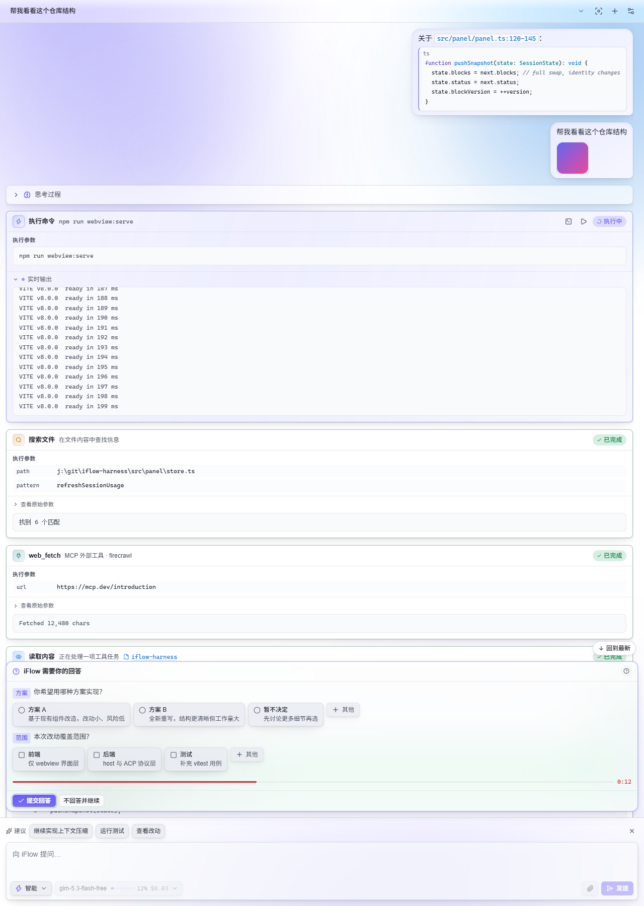

## 亮点

- **完整 agent 工作流**：流式对话、审批卡内嵌只读 Diff（批的是变更本身而不是一个标题）、行号 Diff 逐块 hunk 保留/回退、Plan 计划确认卡（可在卡内编辑并重新规划）、交互式提问卡、子代理进度卡片与单独停止、消息排队与打断发送（Steer）。
- **可回退的长任务**：轮级 Checkpoint 影子快照支持「回滚到此轮」（文件 / 对话 / 两者），编辑旧消息重发自动先恢复该轮快照；速率限制递增退避自动重试、上下文溢出自动压缩并重发——限流与长上下文都不再中断任务。
- **记忆与项目知识库**：设置页直接读写内核真正加载的全局与项目记忆文件（按事实条目增删、token 成本、冲突检测）；助手消息「记住这条」与编辑器右键「记住选中内容」；回合末自动提取长期记忆候选，**只进审阅对话框，确认才写盘**；项目知识库生成 `.iflow/knowledge/index.md`，支持增量刷新（无变化不调模型）。
- **模型元数据不编造**：模型列表实时查询当前 endpoint 的 `/models`；上下文窗口、单价与思考能力可由「联网补充模型数据」补齐——宿主侧直连检索官方资料，交给当前模型提炼，解析器逐条校验溯源（数字必须能在引用的来源原文中找到），不满足即整条丢弃。
- **MCP 与 CLI 资产可视化管理**：MCP 目录卡片带连接状态圆点与 `≈N tokens` 上下文成本（真实 BPE 口径），详情子页展示工具 schema、prompts 与失败原因；配置编辑器表单化（全局 / 项目双作用域）；技能 / 命令 / 子代理资产可视化浏览。
- **凭据与审批安全**：API Key 只存 VSCode SecretStorage（不落盘明文、不打日志），面板配置与终端内核隔离；审批默认拒绝、5 分钟超时自动拒答并带存活看门狗；Webview 走 nonce CSP + DOMPurify 净化；协议层文件读写已做目录边界校验。
- **精致界面**：统一控件套件（按钮 / 输入 / 下拉 / 开关 / 滑块 / 浮层只有一个之家）、Win12 风格亚克力材质、深浅色主题、可调字号与密度、可调极光背景、Mermaid 图表、超长会话离屏渲染不卡。
- **内核兼容增强**：内置一组定制 Mod/loader——按模型配置输出 token 上限、真实上下文窗口计算、Kimi 采样参数规范化、多模态视觉跟随当前模型、思考参数规则、MCP 后台发现与跨会话连接池、slash 压缩结果落盘、按 agentId 单独停止子代理、权威上下文占用上报、MCP 连接状态上报、系统提示词覆写（cwd / git HEAD / 当前模型保持 live）、API 配置隔离（面板凭据不泄漏进共享 settings.json）、联网搜索后端替换（第三方网关 key 也能检索）。

## 功能

**对话与生成**

- 流式对话：思考过程折叠、Markdown 渲染（代码块语法高亮 + Mermaid 图表）、一键中断
- 消息排队与打断发送：生成中继续输入即入队（上限 10 条），队列条支持编辑取回 / 删除 / 上下移 / 立即发送（打断当前轮）；本轮失败自动暂停队列
- 子代理卡片：按类型着色、步骤进度、嵌套子代理、token 与耗时统计，可单独停止某个子代理（父代理继续跑）
- 提问卡：agent 发起提问时渲染交互卡，支持单选 / 多选 / 自由文本，选项自带说明；超时按「未回答」自动继续
- Plan 模式审批：agent 提交计划时弹出确认卡，可在卡内编辑计划并「重新规划」回传修订文本；计划同时落盘 `.iflow/specs/` 供跨会话追溯
- 回合末一次调用：AI 标题、下一步建议、记忆提取合并成一次模型请求（按已开启项拼任务），缺项降级为空，绝不伪造
- 消息操作：重新生成、复制、记住这条
- 用量与成本：会话累计 token 消耗（末次请求上下文为权威值，其余真实 BPE 估算），输入 / 输出分列、上下文占用百分比与成本估算实时刷新
- 自动恢复：速率限制递增退避重试，上下文溢出自动压缩并重发原 prompt，等待过程以倒计时通知呈现
- 会话管理：历史搜索 / 切换 / 重命名 / 置顶 / 归档 / 删除（两步确认）、重启后自动恢复

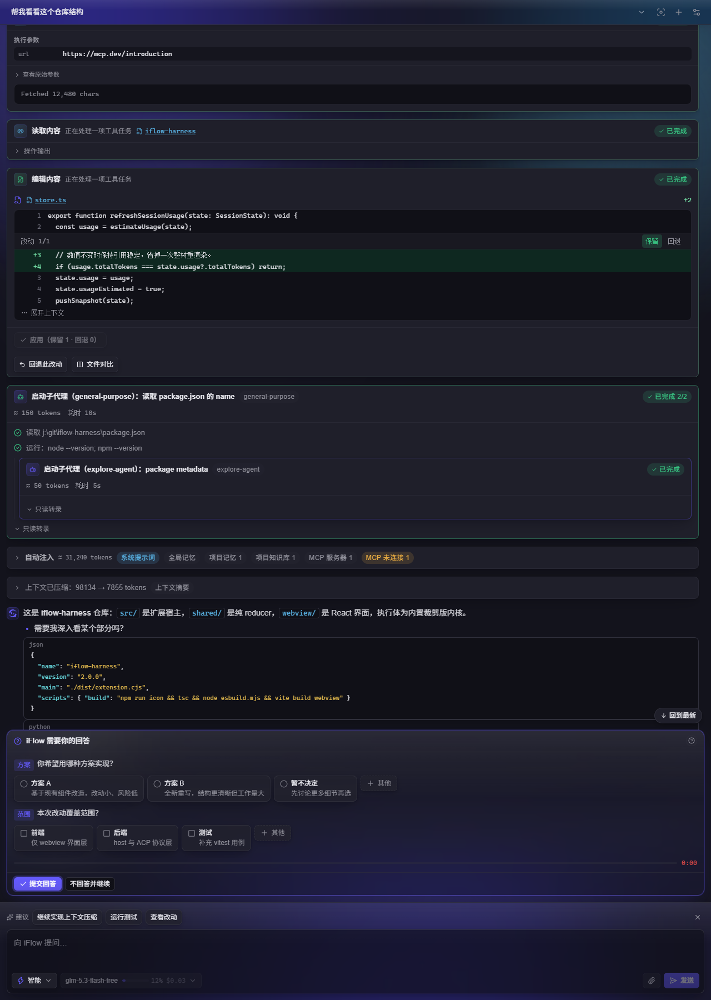

**工具与审批**

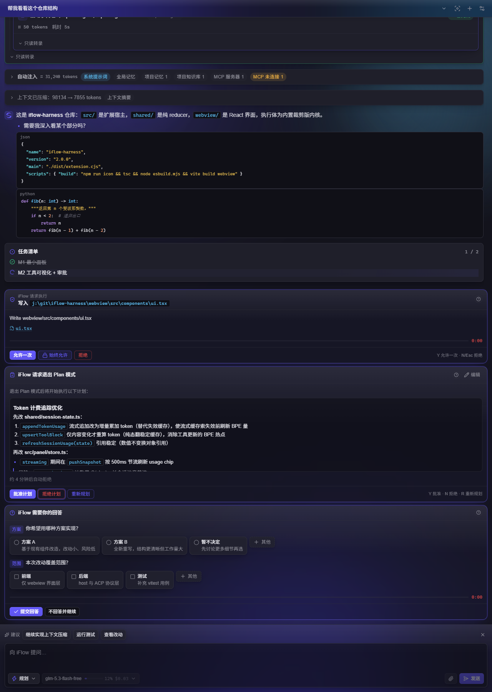

- 工具调用卡片：按工具名映射标签 / 图标 / 强调色，执行参数结构化摘要 + 原始参数懒挂载折叠，长驻命令实时输出流
- 行号 Diff 视图：每个 hunk 可单独保留 / 回退，提交后按保留块确定性写盘；支持整文件回退与 VSCode 原生并排对比（文件对比）
- 审批流：请求卡片（允许一次 / 始终允许 / 拒绝），5 分钟超时自动拒绝并带存活看门狗解锁输入；键盘快捷键 `Y` / `N`
- 审批策略规则表：设置页可视化编辑规则并预览命中（工具类别 / 路径 glob / 命令首词 / 工具名维度），allow 规则对破坏性命令（`rm` / `git push` 等）硬否决降级为询问卡

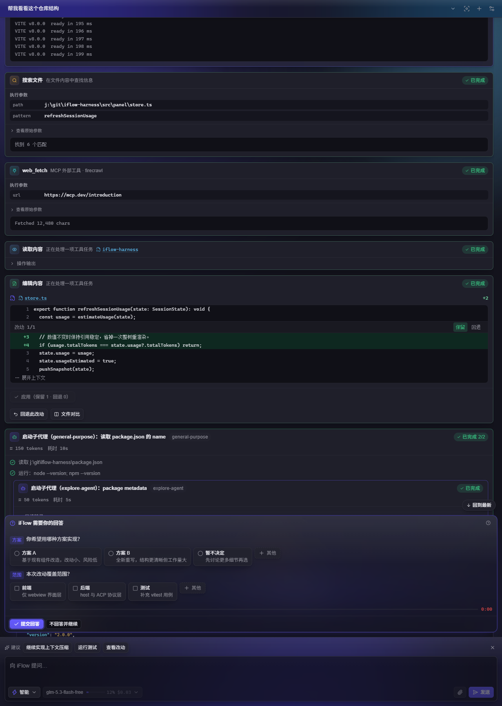

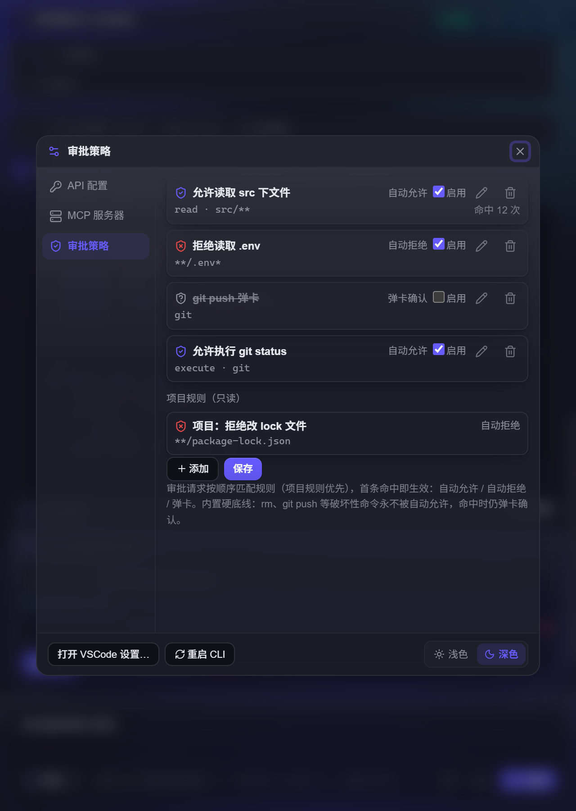

**Checkpoint 与工作区回退**

- 每轮对话前把工作区快照到独立的影子 git 仓库（绝不触碰你自己的 `.git`，非 git 目录同样可用）
- 用户气泡「回滚到此轮」三档恢复：仅文件 / 仅对话 / 文件+对话；编辑器未保存修改与整仓覆盖双重复确认
- 快照容量可治理：文件数 / 单文件大小 / 轮数 / 总体积上限，超限自动关闭或清理

**上下文与输入**

- `@` 上下文源：`@文件` 工作区模糊搜索、`@/` 文件夹搜索、`@problems` 注入工作区诊断、`@git` 注入 status+diff、`@url:` 抓取网页正文、`@terminal` 注入终端记录
- 上下文透明卡：每次请求实际注入的系统提示词、记忆、context files、知识库与 MCP 声明渲染成可展开的注入卡，附 token 成本与未连接标注
- 选区上下文：编辑器右键询问 iFlow（直接提问）/ 加入 iFlow 上下文（生成代码上下文卡，发送时前置到 prompt，可移除、多卡并存）
- 附件：粘贴 / 拖拽 / OS 文件选择器多路径添加，图片缩略图回显并可预览（>5MB 图片自动降级为文件附件）
- 提示词增强：一键将草稿改写为更清晰的请求
- Chat Participant：VSCode Chat 中 `@iflow` 纯文本通道，富交互仍在面板内

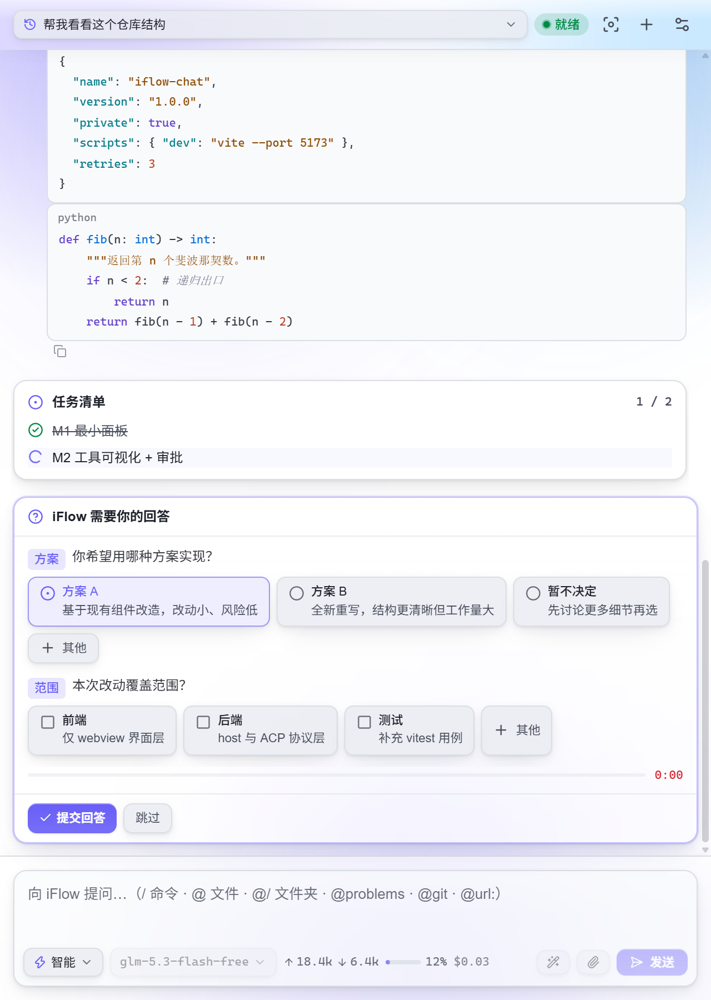

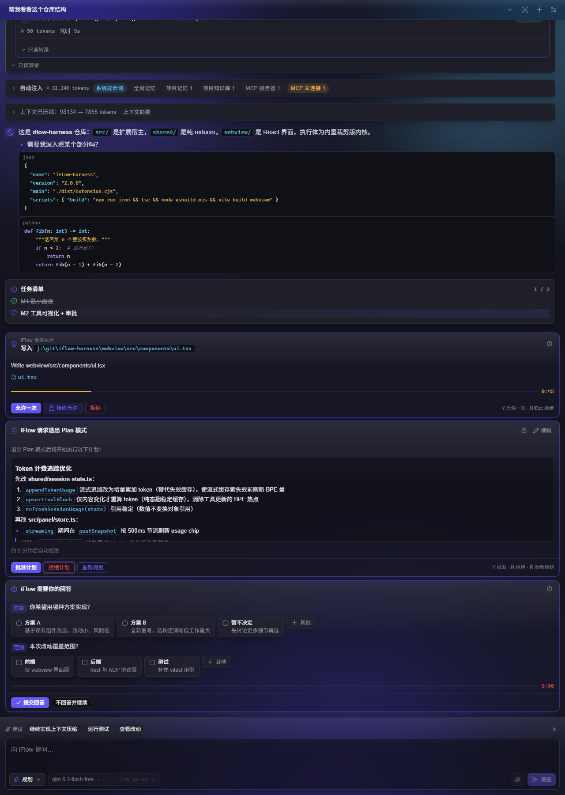

**记忆与知识库**

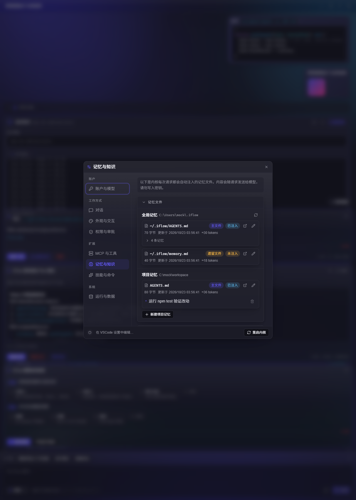

- 记忆管理：读取 / 内联编辑内核实际加载的全局与项目 `AGENTS.md` / `IFLOW.md`，按事实条目追加与删除，展示 token 成本与 sha256 冲突检测；遗留 `memory.md` 只展示不注入
- 快捷记忆：助手消息行内「记住这条」弹窗（全局 / 项目作用域）、编辑器右键「记住选中内容」
- 自动提取：回合结束后用当前模型提取长期偏好与约定作为候选，去重 + 置信度门控 + 最多 5 条，**确认后才写盘**
- 项目知识库：扫描工作区生成 `.iflow/knowledge/index.md` + `manifest.json`，增量刷新只处理新增 / 修改 / 删除的文件，索引 hash 不匹配时要求显式全量重建（绝不静默覆盖手改内容）；注入走托管块 `@import`，遵循内核的 context files 规则

**模型与配置**

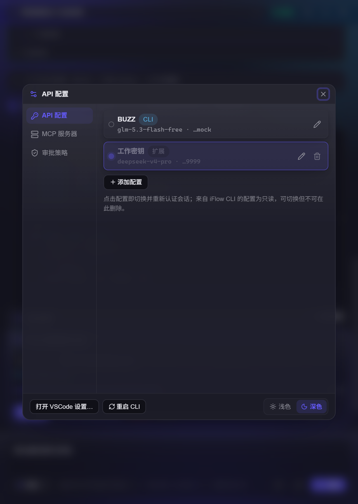

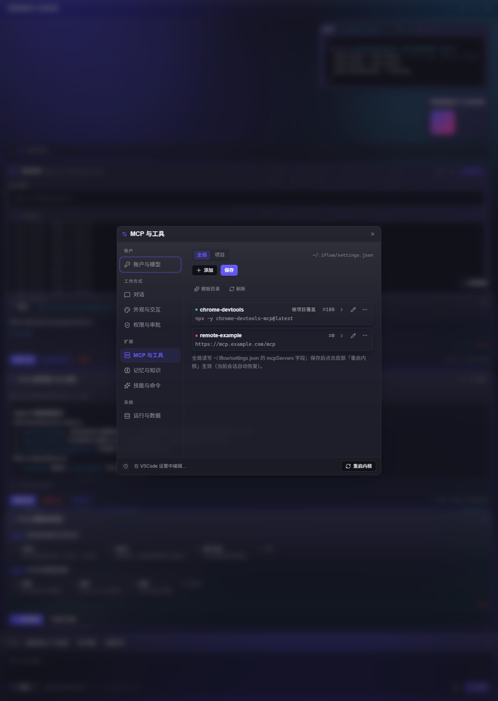

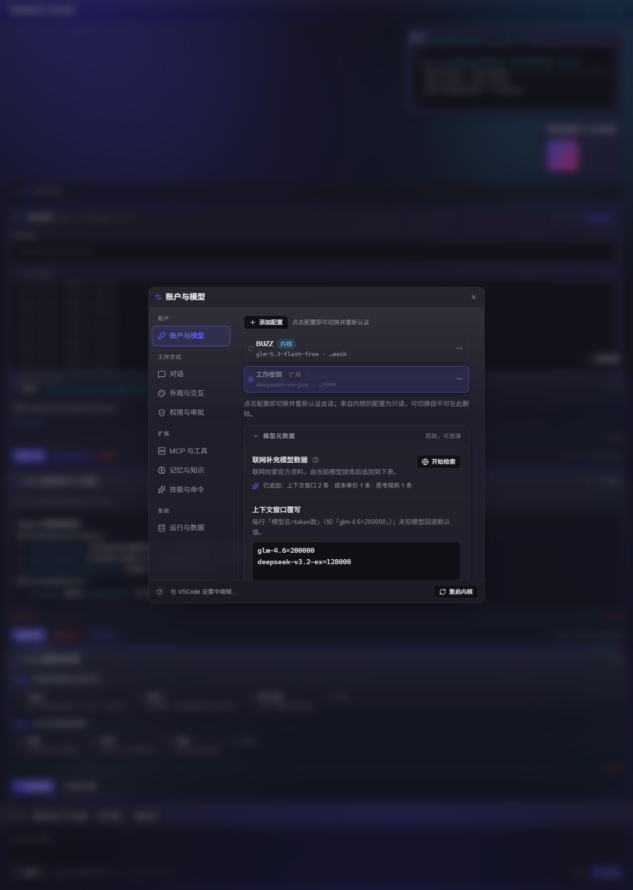

- API 配置：OpenAI 兼容凭据存 SecretStorage，多 Profile 热重认证免重启内核；切换时可选择保留当前会话原地重载；首次使用有引导向导与提供商预设（切换预设不继承旧网关模型名）
- 模型列表实时查询当前 endpoint 的 `/models`，下拉模糊搜索；模型下架时显式回退并提示，绝不静默用错模型
- 模型元数据：上下文窗口覆写、成本单价表、思考能力规则；「联网补充模型数据」宿主侧检索官方资料后由当前模型提炼，逐条溯源校验并**只追加不覆盖**
- 推理级别：自动 / 快速 / 平衡 / 深度，按模型能力灰化；规则与 `~/.iflow/thinking-models.json` 双向同步
- MCP 服务器管理：目录卡片显示连接状态、工具数与上下文成本，详情子页含 transport / schema / 失败原因；表单化编辑器支持全局与项目双作用域，保存原子写回并一键热重启
- CLI 资产：技能 / 命令 / 子代理列表可视化浏览与编辑
- 会话导出：Markdown / JSON / 脱敏 ACP 通信日志（命令面板）

**界面与通知**

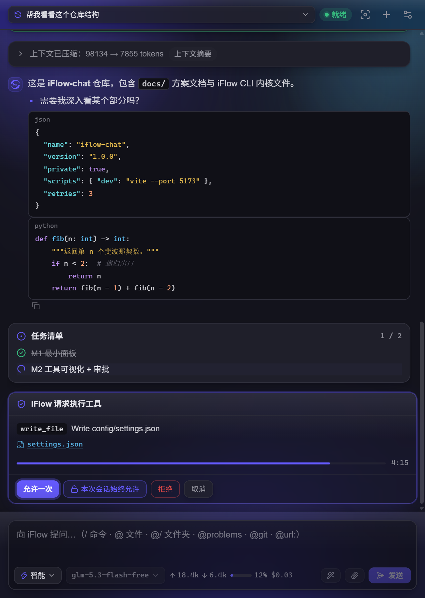

- 主题：深 / 浅色切换，默认跟随编辑器主题；字号（紧凑 / 标准 / 大）与密度（紧凑 / 标准 / 宽松）可调；极光背景强度可调
- Focus 视图只看对话；状态栏显示 agent 状态（连接中 / 就绪 / 生成中 / 等待审批 / 出错）与当前模型，点击打开面板
- 通知分层：面板内 toast 栈与粘性「生成中」pill（限流 / 压缩倒计时合并进 pill，锚定宿主绝对截止时间）、错误与未配置凭据走转录上方的 inline banner、离开面板时按策略发 OS 系统通知
- 提示音：完成 / 失败音效（Web Audio 合成，无需资源文件）
- 长会话：超长转录离屏渲染 + 后缀挂载窗口，折叠内容首次打开才挂载，旧块重 payload 自动释放

## 前置要求

- VSCode `^1.90.0`
- 无需单独安装 iFlow CLI
- 可用的 OpenAI 兼容 API 端点（baseUrl + apiKey + modelName）

## 扩展设置

**面板行为**

| 设置项 | 说明 |
|---|---|
| `iflow.defaultMode` | 新会话默认权限模式：`smart` / `yolo` / `default` / `plan` |
| `iflow.warmStart` | 窗口打开时后台预热内核，首次打开面板无需等待（默认开启，每窗口约 100MB 内存） |
| `iflow.autoOpenPanel` | VSCode 启动时自动打开聊天面板 |
| `iflow.restoreLastSession` | 面板启动时恢复上次使用的会话（无可恢复记录自动回退新建） |
| `iflow.autoTitle` | 会话首轮完成后生成 AI 简短标题 |
| `iflow.nextStepSuggestions` | 每轮结束后预测下一步操作，显示为输入框上方的 chip（额外一次模型调用） |
| `iflow.autoCompressOnIdle` | 回合结束且上下文占用达到 95% 时，在下一条消息前自动压缩（默认关闭） |
| `iflow.autoMemoryCapture` | 每轮结束后提取长期记忆候选，确认后才写盘（默认开启，额外 token 消耗） |
| `iflow.soundFeedback` | 对话完成 / 失败时播放提示音（默认开启） |
| `iflow.osNotifications` | 面板不可见时的系统通知：`off` / `approvals`（默认）/ `all` |
| `iflow.theme` | 面板主题：`auto` 跟随编辑器颜色主题，或固定 `light` / `dark` |
| `iflow.uiFontSize` / `iflow.uiDensity` | 面板字号与间距密度：紧凑 / 标准 / 大（或宽松） |
| `iflow.auroraIntensity` | 背景极光光斑强度（0–100，默认 35） |

**模型与内核**

| 设置项 | 说明 |
|---|---|
| `iflow.contextWindowOverrides` | 模型上下文窗口覆写，每行 `模型名=token数` |
| `iflow.costTable` | 成本估算单价表，每行 `模型名=输入价,输出价`（USD/百万 token） |
| `iflow.thinkingModelRules` | 思考能力规则（正则匹配模型 id，首个命中生效），与 `~/.iflow/thinking-models.json` 双向同步 |
| `iflow.nodePath` | 启动内核使用的自定义 Node.js 可执行文件 |
| `iflow.language` / `iflow.approvalMode` | 写入 `~/.iflow/settings.json` 的内核界面语言 / 默认审批模式（留空不干预），重启内核后生效 |

**Checkpoint（轮级快照与回退）**

| 设置项 | 说明 |
|---|---|
| `iflow.checkpoints` | 每轮对话前快照工作区到影子 git 仓库（默认开启） |
| `iflow.checkpointMaxFiles` | 工作区文件数超过该上限时关闭快照（默认 50000） |
| `iflow.checkpointMaxFileMB` | 跳过大于该尺寸（MB）的文件，0 = 不限 |
| `iflow.checkpointDir` | 快照仓库自定义根目录，留空用默认存储位置 |
| `iflow.checkpointMaxTurns` | 每会话最多保留的快照轮数，0 = 不限 |
| `iflow.checkpointMaxSizeMB` | 快照仓库总体积上限（MB），0 = 不限 |

## 使用

1. 安装扩展后，点击状态栏右侧的心流状态项打开面板（也可用编辑器标签栏图标或命令面板 `iFlow: 打开聊天面板`）；面板是独立编辑器标签页，宽度可自由拖拽
2. 首次使用按引导向导配置 API 凭据（OpenAI 兼容地址 + Key + 模型名），或切换内核已有的配置
3. 输入消息开始对话；生成中可以继续输入排队、「立即发送」打断当前轮；工具调用会在面板中请求审批，Diff 卡片支持逐块保留 / 回退与文件对比；用户气泡可回滚到此轮
4. 输入框 `@` 触发文件 / 文件夹 / 诊断 / git / 网页 / 终端上下文；Chat 视图中 `@iflow <问题>` 走纯文本通道快速提问
5. 需要模型窗口与单价数据时在设置「账户与模型」里点「联网补充模型数据」——宿主侧检索、当前模型提炼、溯源校验后追加到元数据表

> **安全与信任边界**：内核的执行类工具（`run_shell_command` 等）运行在本机真实 shell 中，可以读写会话目录之外的任意路径——审批卡是「告知 + 同意」，不是沙箱隔离。请在信任的项目中使用；处理不信任的代码库时，建议在容器 / 虚拟机中运行 VSCode。扩展侧的 `fs/read_text_file` / `fs/write_text_file` 回调已做目录边界校验（允许范围 = 会话目录 + 所有已打开工作区根；`..` 上逃与指向范围外的绝对路径会被拒绝），但这只封住了协议层通道，不替代操作系统级隔离。

## License

[MIT](LICENSE)
